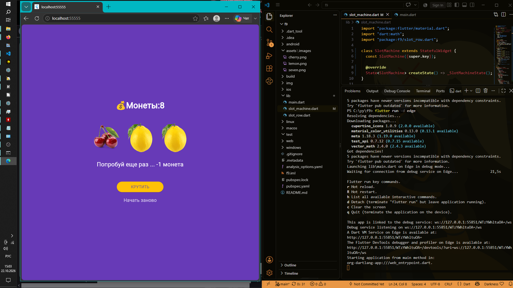

# Flutter 9 

### Исполнитель
* **Фамилия Имя:** Чумаченко Михаил
* **Группа:** ИСП-242


## Что было изучено и реализовано в ходе работы:
1. **Различие между StatelessWidget и StatefulWidget:** Поняли, в каких случаях UI должен быть статичным, а в каких — динамически обновляемым в зависимости от действий пользователя.
2. **Управление состоянием через setState():** Научились уведомлять Flutter об изменениях внутренних переменных (монет, выбранных картинок) для автоматической перерисовки интерфейса.
3. **Подключение локальных ресурсов (assets):** Освоили регистрацию изображений в конфигурационном файле `pubspec.yaml` с соблюдением строгой структуры отступов.
4. **Асинхронное программирование (async/await):** Реализовали реалистичную прокрутку барабанов слот-машины с эффектом замедления и поочерёдной остановки.
5. **Валидация состояний и защита UI:** Настроили блокировку кнопок «КРУТИТЬ» и «Начать заново» при нулевом балансе монет или во время вращения барабанов.
6. **Базовая анимация компонентов:** Применили встроенные виджеты `AnimatedOpacity` для мигания барабанов и `AnimatedSwitcher` для красивого переключения текстовых сообщений.


## Скриншот финального приложения



## Инструкция по запуску проекта


1. **Клонируйте репозиторий и перейдите в папку проекта:**

   ```bash
   git clone <url>
   ```

   ```bash
   cd f9
   ```

2. **Загрузите зависимости проекта:**
   ```bash
   flutter pub get
   ```

3. **Запустите приложение в Edge:**
   ```bash
   flutter run -d edge
   ```
